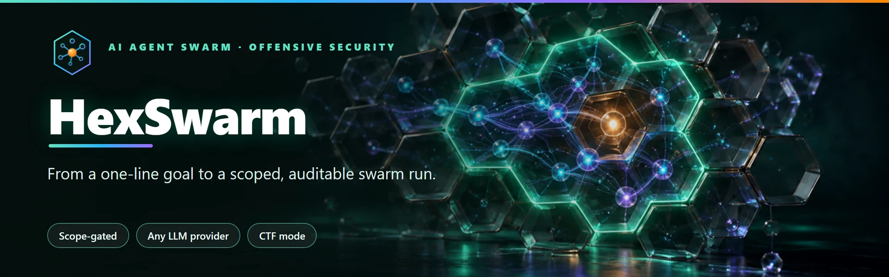
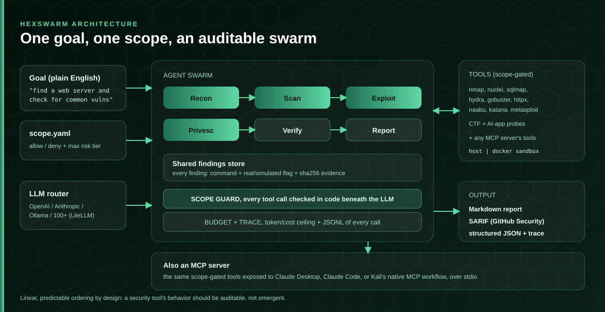
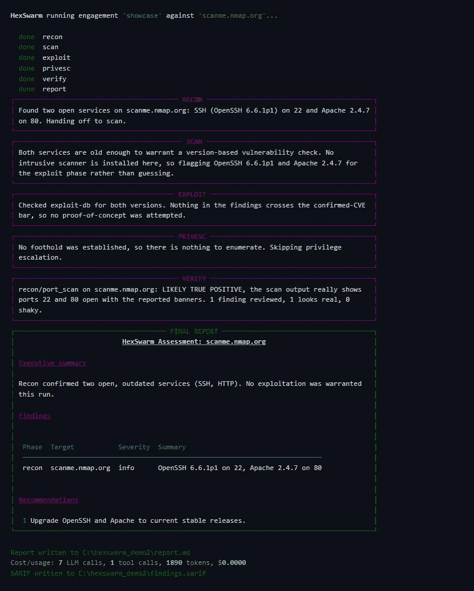
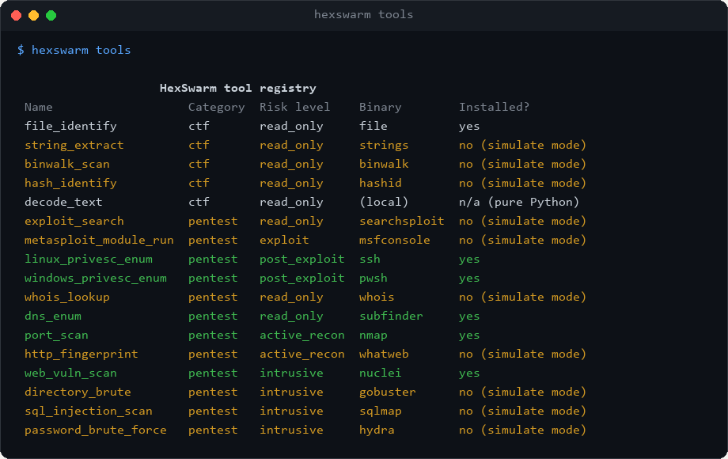
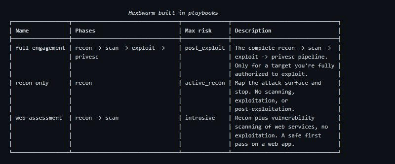
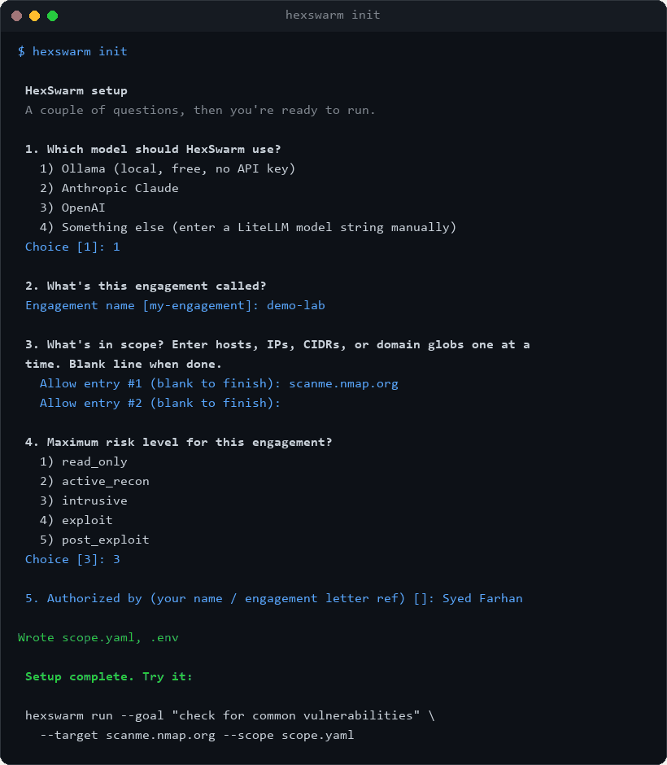
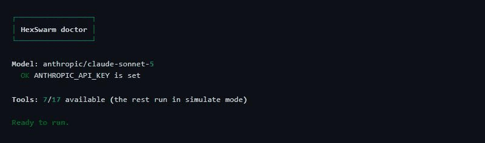
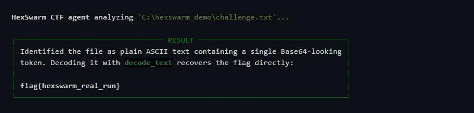
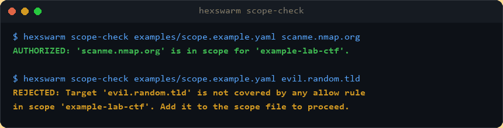
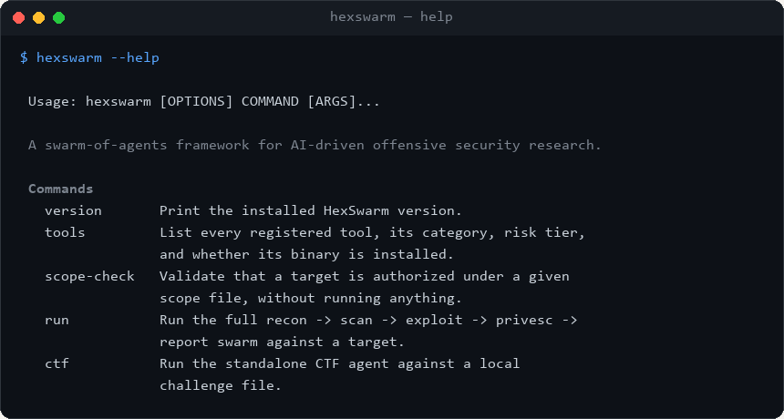

<h1 align="center"></h1>

<p align="center">
  <a href="https://github.com/farhan6667/hexswarm/actions/workflows/ci.yml"></a>
  <a href="LICENSE"></a>
  
  
  
</p>

**HexSwarm is an open source Python framework for running AI agents against authorized penetration testing, bug bounty, and CTF targets.** Independent project by Syed Farhan Ahmed (SFA) at NexaForge. It wraps publicly available security tools (nmap, Nuclei, gobuster, sqlmap, Hydra, Metasploit, searchsploit, and others) via their own CLIs; it is not affiliated with, sponsored by, or endorsed by any of their maintainers or vendors.

<p align="center">
  <a href="https://opencollective.com/nexaforge-oss"><picture>
    <source media="(prefers-color-scheme: dark)" srcset="docs/img/sponsor-button-dark.webp">
    
  </picture></a>
</p>

It connects to OpenAI, Anthropic, local Ollama models, or 100+ other providers through one interface, and gives those agents a scoped,
safety-gated library of real offensive-security tools (recon, vulnerability scanning, exploitation, and privilege escalation), so a single
high-level goal like "find a web server on this target and check for common vulnerabilities" turns into a coordinated, auditable swarm run.

## At a glance

| | |
|---|---|
| **Runs** | `recon -> scan -> exploit -> privesc -> report`, a multi-agent pipeline against one authorized target per engagement |
| **Gates** | Every tool call against an explicit `scope.yaml` allow/deny list and a max risk tier, enforced in code beneath the LLM, not in its prompt |
| **Connects to** | OpenAI, Anthropic, local Ollama, or 100+ other providers through [LiteLLM](https://github.com/BerriAI/litellm), one config line to switch |
| **Caps spend** | A hard cost/token budget that aborts the run the moment it's crossed, plus a JSONL trace of every call's cost, so an autonomous run can't quietly run up a bill |
| **Proves findings** | Every finding carries the exact command, a real-vs-simulated flag, and a hash of its output; an optional `--verify` pass flags likely false positives |
| **Speaks MCP** | Exposes its tools to any MCP client (Claude Desktop, Kali's native workflow) and can pull in tools from other MCP servers, all still scope-gated |
| **Sandboxes** | Optional per-tool Docker isolation; a Kali-based toolchain image for real execution |
| **Also solves** | CTF challenges (file ID, decoding, steg) and AI-app testing (`ai-audit` for prompt injection), no network scope needed for CTF |
| **Exports** | Markdown report, SARIF (GitHub Security tab), and structured JSON |
| **Onboards with** | `hexswarm init` (guided setup), `hexswarm doctor` (readiness check), playbooks, and bundled `lab` targets for safe end-to-end testing |
| **Never fakes** | A missing tool binary runs in clearly labeled simulate mode instead of crashing or silently skipping |
| **Status** | Stable (1.0). 239 automated tests, ruff/mypy/bandit clean; validated end to end in CI against a live OWASP Juice Shop lab; also fuzz-tested (hypothesis) against hostile input to the scope guard and path confinement |

## How it fits together

<p align="center"></p>

## Screenshots

**`hexswarm run --verify --sarif-out`**, a real recon pass against scanme.nmap.org through the full pipeline, with the verification pass, the final Markdown report, a cost/usage line, and SARIF export:

<p align="center"></p>

**`hexswarm tools`**, the full registry with categories and risk tiers color-coded:

<p align="center"></p>

**`hexswarm playbooks`**, the built-in engagement presets:

<p align="center"></p>

<details>
<summary>More: init wizard, doctor, CTF, scope-check, help</summary>

<p align="center"></p>
<p align="center"></p>
<p align="center"></p>
<p align="center"></p>
<p align="center"></p>

</details>

## Why HexSwarm exists

Most "AI pentesting" demos are a single agent in a loop with a handful of hardcoded shell calls. That's fine for a conference talk and useless for
real engagement work, because nobody can tell what it's allowed to touch, what model it's trusting its judgment to, or what it actually ran.

HexSwarm is built around three non-negotiables instead:

- **Scope is law.** Every single tool call, recon, scan, exploit, or privesc, is checked against a scope file before it runs. No scope file, no run.
  An agent cannot "accidentally" touch something outside the engagement, because the scope guard sits underneath the LLM, not inside its prompt.
- **You pick the brain.** Swap OpenAI for Anthropic for a local Ollama model with one config line, no code changes, no vendor lock-in. Run a cheap
  local model for recon and a stronger cloud model for exploit reasoning in the same run if you want.
- **Every finding is attributable.** HexSwarm never silently fakes output. If a tool's binary isn't installed on the host, it says so and returns a
  clearly labeled simulated result instead of guessing, so you always know whether a finding came from a real scan or a dry run.

None of that should cost you a rough setup experience: `hexswarm init` writes your config and scope file for you, `hexswarm doctor` tells you what's
missing before a run does, and `run`/`ctf` show a live status line per phase instead of going silent, then print each phase's output and the final
report as properly rendered Markdown panels, not a wall of raw text.

## How it works

HexSwarm runs a linear swarm of five specialized agents, each scoped to only the tools appropriate for its phase:

```
  Recon  ───▶  Vulnerability Scan  ───▶  Exploit  ───▶  Privilege Escalation  ───▶  Report
(read-only +   (nuclei, gobuster,      (searchsploit,    (post-exploitation            (Markdown
 active recon:  sqlmap, hydra)          Metasploit)        enumeration only,             findings
 whois, DNS,                                                after a foothold             report)
 nmap, whatweb)                                             already exists)
```

Findings accumulate in a shared store as the swarm progresses, so the exploit agent sees what recon actually found instead of guessing, and the
report agent writes up the whole engagement at the end, honestly noting which results were real tool runs and which were simulated.

```bash
hexswarm run \
  --goal "find a web server on this target and check for common vulnerabilities" \
  --target scanme.nmap.org \
  --scope examples/scope.example.yaml
```

Before anything runs, HexSwarm shows the engagement name, target, who authorized it, and the max risk level from your scope file, and asks you
to confirm once. Pass `--yes` to skip that prompt for CI or scripted use.

### CTF mode

CTF challenges aren't network targets, so they get their own agent and command, no scope file needed:

```bash
hexswarm ctf --goal "find the flag in this binary" --file ./challenge.bin
```

The CTF agent identifies the file type, pulls printable strings, checks for embedded data, and tries common encodings (Base64/Base32/hex/
URL/ROT13/binary) on anything that looks encoded, chaining its own tool outputs together until it finds a flag or runs out of obvious angles.

### AI/LLM application testing

An AI-native framework testing other AI-native applications is a natural fit, and AI-in-scope bug bounty programs grew 270% in HackerOne's
2025 data. This probes a target chat/LLM HTTP endpoint for prompt-injection and system-prompt-leak weaknesses, same scope-file requirement as `run`:

```bash
hexswarm ai-audit --target https://app.example.com/api/chat --scope scope.yaml
```

A flagged response is a text-pattern heuristic hit, worth a human reading the actual reply, not a confirmed vulnerability. Read it the same
way you'd read any other scanner's output here.

### MCP: use HexSwarm's tools from any MCP client, or pull in someone else's

[MCP](https://modelcontextprotocol.io/) is where AI-driven security tooling is heading in 2026: Kali Linux now ships a native MCP-based Claude
workflow, and projects like PentestMCP expose pentest tooling the same way. HexSwarm speaks MCP in both directions.

Expose every HexSwarm tool to Claude Desktop, Claude Code, or any other MCP client:

```bash
hexswarm mcp-server --scope scope.yaml
```

Every call still goes through the exact same `ScopeGuard` as the CLI and the built-in agents: MCP is a different transport for the same
gated tool registry, not a looser path around it.

Pull tools from someone else's MCP server into a HexSwarm agent, via a small YAML config (see
[`examples/mcp_servers.example.yaml`](examples/mcp_servers.example.yaml)):

```yaml
servers:
  - name: pentestmcp
    command: python
    args: ["-m", "pentestmcp"]
    risk_level: "exploit"
```

Then pull them into an engagement with `hexswarm run --mcp-config mcp_servers.yaml ...`. HexSwarm doesn't know what an arbitrary external tool
actually does, so you declare the risk tier (and, per tool, whether its target is even a network host) when you add the server, the same trust
decision as adding any new tool.

### Pausing before the dangerous steps

By default a run is autonomous once you approve the scope. For a tighter leash, `--confirm-from` makes it pause for your confirmation only at a
given risk tier and above, while lower tiers keep running on their own:

```bash
hexswarm run --playbook full-engagement --target ... --scope ... --confirm-from exploit
```

That lets recon and scanning run unattended but stops to ask before anything in the exploit or post-exploit tiers fires.

### Sandboxing each tool call in its own container

By default every tool runs as a plain subprocess on the host, same as always. Setting `HEXSWARM_SANDBOX=docker` switches every tool call to
run inside its own disposable `docker run --rm` instead: one fresh container per call, isolated from the host, from HexSwarm itself, and from
every other tool call in the run. That's a meaningfully different safety posture than "the whole app happens to run inside a Dockerfile."

```bash
HEXSWARM_SANDBOX=docker HEXSWARM_SANDBOX_IMAGE=ghcr.io/farhan6667/hexswarm-toolchain:latest hexswarm run ...
```

`ghcr.io/farhan6667/hexswarm-toolchain` (built from [`Dockerfile.toolchain`](Dockerfile.toolchain)) is a Kali-based image with the real
toolchain installed: `hexswarm tools` reports every binary as actually present when run inside it, not simulate mode.

### Benchmarking a model/version

```bash
hexswarm bench
```

Runs the CTF agent against a small CTF-style challenge set bundled with the package ([`src/hexswarm/data/benchmarks/`](src/hexswarm/data/benchmarks/))
and reports a pass count, in the spirit of Cybench/NYU-CTF Bench but tiny and fully offline: "solved 5/6" is a number anyone can reproduce by
running the same command against the same challenges, not a vibe. It ships in the wheel, so it works from a plain `pip install` too.

### Capping spend and seeing where it went

Agents burn far more tokens than a chatbot, and an unsupervised autonomous run can quietly cost real money. Put a hard ceiling on it:

```bash
hexswarm run --playbook web-assessment --target ... --scope ... \
  --max-cost 2.00 --max-tokens 500000 --trace-out run.jsonl
```

The run aborts the moment either ceiling is crossed (and still writes a report over whatever was found first). `--trace-out` records one
JSON line per LLM call and tool call, with tokens, cost, phase, timing, and whether the tool was simulated, so a run is fully auditable after
the fact. Both are opt-in; without them nothing is tracked.

### Evidence, verification, and CI-ready output

Every finding carries the exact command that produced it, a real-vs-simulated flag, and a sha256 of its full output, so it traces back to a
reproducible command and can't be passed off as real when it was a dry run. Add `--verify` for a second-opinion pass that reviews each
medium-or-higher finding against its evidence and flags likely false positives before the report. Export for the rest of your toolchain:

```bash
hexswarm run ... --verify --sarif-out findings.sarif
```

SARIF drops straight into GitHub's code-scanning / Security tab; a plain JSON export is also available.

### Playbooks

Named presets that bundle the goal, phase order, and a risk cap so you don't retype them. A playbook can only *narrow* the scope file's risk
cap, never widen it, and never carries a scope or target of its own:

```bash
hexswarm playbooks                      # list built-ins
hexswarm run --playbook recon-only --target ... --scope ...
```

Built-ins: `recon-only`, `web-assessment`, `full-engagement`. Point `--playbook` at a YAML path for your own.

### Bundled vulnerable labs

Validate the real pipeline against a genuinely vulnerable app, safely, on your own machine:

```bash
hexswarm lab up juice-shop
hexswarm run --playbook web-assessment --target http://localhost:3000 \
  --scope examples/labs/juice-shop.scope.yaml --yes
hexswarm lab down juice-shop
```

The lab is localhost-bound and disposable, and ships with a matching scope file. Needs Docker + the compose plugin.

## Install

```bash
git clone https://github.com/farhan6667/hexswarm.git
cd hexswarm
pip install -e .
hexswarm init
```

`hexswarm init` is a guided setup wizard: it asks which model to use (a local Ollama model needs no API key at all), what's in scope, and how
aggressive the engagement is allowed to get, then writes a working `.env` and `scope.yaml` for you. No hand-editing YAML or memorizing the
risk-level vocabulary. It ends by printing the exact `hexswarm run` command for what you just configured.

Before pointing it at a real target, run:

```bash
hexswarm doctor
```

It checks that your configured model is actually reachable (starts Ollama? has an API key set?) and reports how many of the built-in
tools are installed on this machine, so you find out about a missing piece before a 20-minute engagement run does.

HexSwarm itself has no heavy dependencies, it's a thin orchestration layer. The underlying security tools (`nmap`, `nuclei`, `gobuster`,
`sqlmap`, `hydra`, `searchsploit`, Metasploit, the ProjectDiscovery stack `httpx`/`naabu`/`katana`/`dnsx`/`subfinder`, plus `amass`,
`theHarvester`, `SubOver`, `dalfox`, and `garak` for LLM testing, and `file`/`strings`/`binwalk`/`hashid` for CTF mode) are expected to live
on a proper pentest host (Kali, a security-focused Linux box, or WSL). If a binary isn't present, the matching tool runs in simulate mode automatically, so the
framework and its test suite work anywhere Python runs.

Prefer a container to a bare host? `docker build -t hexswarm .` gives HexSwarm an isolated place to run. The default image doesn't bundle the
pentest toolchain (see the comment at the top of the [Dockerfile](Dockerfile) for how to layer it on top of a Kali base image), so out of the
box it runs the same way a plain dev machine does: real logic, simulated tool output.

You don't have to build it yourself. Every release publishes a ready-made image to the GitHub Container Registry, and GitHub serves the
download, so pulling it puts no load on this project's own hosting:

```bash
# the app image (the thin orchestration layer)
docker pull ghcr.io/farhan6667/hexswarm:latest        # or a pinned tag like :1.0.0
docker run --rm ghcr.io/farhan6667/hexswarm:latest --help

# the Kali-based toolchain image, with the real pentest tools already installed
docker pull ghcr.io/farhan6667/hexswarm-toolchain:latest
```

Both packages are listed under the repository's [Packages](https://github.com/farhan6667/hexswarm/pkgs/container/hexswarm) and are free to pull.

## Configure a model

Copy `.env.example` to `.env` and set one model string:

```bash
# Local, free, private
HEXSWARM_PRIMARY_MODEL=ollama/llama3.1

# Or a hosted model
HEXSWARM_PRIMARY_MODEL=anthropic/claude-sonnet-5
HEXSWARM_FALLBACK_MODELS=openai/gpt-4o
```

Model routing goes through [LiteLLM](https://github.com/BerriAI/litellm), so any provider string it recognizes works here without touching
HexSwarm's code.

## Define your scope before you run anything

```yaml
engagement_name: "example-lab-ctf"
allow:
  - "10.10.10.0/24"
  - "scanme.nmap.org"
deny:
  - "10.10.10.1"
max_risk_level: "intrusive"   # read_only | active_recon | intrusive | exploit | post_exploit
authorized_by: "Your Name / engagement letter reference"
```

Validate it on its own before a real run:

```bash
hexswarm scope-check examples/scope.example.yaml scanme.nmap.org
```

## Extending HexSwarm

Adding a tool is a small, self-contained class:

```python
from hexswarm.tools.base import Tool, ToolRegistry
from hexswarm.safety.guard import ToolRiskLevel

class MyScanner(Tool):
    name = "my_scanner"
    description = "What this tool does and when an agent should reach for it."
    binary = "my-scanner-cli"
    risk_level = ToolRiskLevel.INTRUSIVE

    def build_command(self, **kwargs):
        return [self.binary, "--target", kwargs["target"]]

ToolRegistry.register(MyScanner())
```

It's picked up automatically by whichever phase agent matches its `risk_level`, no orchestrator changes needed. Set `category = "ctf"` instead
of the default `"pentest"` if it belongs to the CTF agent rather than the network pipeline, and `requires_scope_check = False` if its `target`
is a local file path or search string rather than an actual network host (the scope guard would otherwise reject every call, since a file path
can never match a host/CIDR/domain allow rule).

## Frequently asked questions

**Is this safe to point at a random website?**
No. HexSwarm refuses to run without an explicit scope file, and every tool call that names a network target is checked against it (a few tools,
like CTF file analysis or a local exploit-database search, have no network target to check by design; see SECURITY.md for exactly which ones
and why). That only enforces *your* intent. It
doesn't make a target legal to test. Only run HexSwarm against systems you own or are explicitly authorized to test (your own lab, a CTF, a
bug bounty program's in-scope assets, or a signed engagement).

**Does it work without an internet connection or API key?**
Yes, if you point `HEXSWARM_PRIMARY_MODEL` at a local Ollama model. No cloud calls, no API key, no cost.

**What happens if `nmap`/`sqlmap`/etc. aren't installed?**
The matching tool runs in simulate mode: it reports that the binary is missing and shows the exact command it would have run, instead of
crashing or silently skipping. Install the real toolchain on a Linux/Kali/WSL host for live results.

**Is "fully autonomous by default" actually safe?**
Autonomy only applies to deciding *which* authorized action to take next, not to *what's* authorized. The scope guard and the per-phase tool
boundaries are enforced in code beneath the LLM, not as a prompt instruction, and they apply identically whether human-in-the-loop confirmation
is switched on or off. HITL is an optional extra layer for anyone who wants per-step confirmation on top of that.

**How is this different from running ChatGPT in a terminal?**
Five things: a scope guard that physically blocks out-of-scope tool calls, a phase-based tool allowlist (the exploit agent literally cannot call
privesc tools), a shared findings store so agents build on each other's work instead of starting from a blank context, provider-agnostic model
routing with automatic fallback, and simulate-mode tooling that keeps the whole pipeline testable without a live target.

**Does CTF mode need a scope file too?**
No. CTF tools analyze a local file or a raw string you already have, there's no network host to authorize, so `hexswarm ctf` doesn't take a
`--scope` argument at all. The network-pentest pipeline (`hexswarm run`) still always requires one.

## Contribute

This project is free and built in the open. The most useful things you can send:

- a **compatibility report** from a real pentest host (Kali, a hardened Linux box, WSL) with the full toolchain installed, since most of this
  was built and tested in simulate mode,
- a **new tool adapter** for something not wrapped yet (see [Extending HexSwarm](#extending-hexswarm) above),
- a fix, a test, or a clearer sentence in the docs.

Start with a [good first issue](https://github.com/farhan6667/hexswarm/labels/good%20first%20issue) or say hello in
[Discussions](https://github.com/farhan6667/hexswarm/discussions). The [contributing guide](CONTRIBUTING.md) explains the two-minute setup.
It carries the `hacktoberfest` topic, and pull requests are welcome whether or not you take part. Please read [SECURITY.md](SECURITY.md)
before reporting a vulnerability in HexSwarm itself rather than opening a public issue.

If your company can help with test infrastructure, hosting, tools, or funding, the
[sponsor page](https://github.com/farhan6667/farhan6667/blob/main/SPONSOR.md) explains how.

## License

MIT, see [LICENSE](LICENSE).

---

<div align="center">

<a href="https://nexaforge.eu.cc/">
  <picture>
    <source media="(prefers-color-scheme: dark)" srcset="docs/img/brand/nexaforge-lockup-dark.webp">
    
  </picture>
</a>
&nbsp;&nbsp;
<a href="https://farhan6667.github.io/portfolio/"></a>

**Built by [Syed Farhan Ahmed](https://github.com/farhan6667) (SFA)** at **[NexaForge](https://nexaforge.eu.cc/)**<br>
Cyber security · Vibe coding · Web development and IT infrastructure

[Website](https://nexaforge.eu.cc/) ·
[LinkedIn](https://www.linkedin.com/in/sfa6667) ·
[Portfolio](https://farhan6667.github.io/portfolio/) ·
[Email](mailto:nexaforge.services@gmail.com)

</div>
